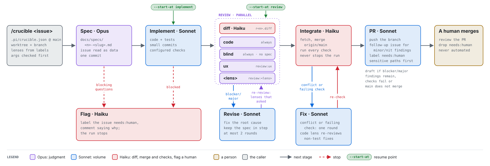

# pi-crucible

[](https://github.com/seandavi/pi-crucible/actions/workflows/ci.yml)

Turn a GitHub issue into a reviewed pull request with a fixed loop of coding agents: **spec →
implement → review → revise → integrate → PR**. Independent reviewers each check one concern, revise
must fix root causes, re-reviewers judge the fix itself, and the branch is tested against the latest
`main` before the PR opens. A person always merges.

It runs on your machine as a [pi](https://pi.dev) package, on
[pi-subagents](https://github.com/nicobailon/pi-subagents). The strong model works where judgment
matters (spec, review), the fast model where volume does (implement, revise, PR), and a small model
does the bookkeeping.

> **Status: an experiment.** More than 30 runs across four repositories, all run by one person. Expect
> breaking changes; the [roadmap](#status-and-roadmap) says what is next. Formerly **pi-factory**
> (renamed in [#23](https://github.com/seandavi/pi-crucible/issues/23); old commands and config names
> still work, with a warning).

<picture>
  <source media="(prefers-color-scheme: dark)" srcset="docs/figures/crucible-flow-dark.svg">
  
</picture>

**Figure 1.** One crucible run. Box colour shows the model each stage runs on. Solid arrows are the
normal path. Dashed red arrows are stops, which label the issue `needs:human` and explain why.
Review lenses run in parallel: `code` always, and each lens the repository defines in
`.pi/crucible.json` when the issue carries its `review:<lens>` label. Before each review round a
Haiku step writes the branch's diff for the reviewers, who have no shell. Only `blocker` and `major` findings send the branch back to
revise, and only the lenses that asked for changes review again. Before the PR, the branch is merged with the
latest main and every check runs. A conflict or a failure gets one fix round, and the `code` lens
re-reviews a fix that touched non-test code. Green pills are the
`--start-at` resume points. Generated by [`docs/figures/make_figures.py`](docs/figures/make_figures.py).

## What a run produces

| Stage | Model | Writes |
|---|---|---|
| Spec | Opus | `docs/specs/<issue>-<slug>.md`, one commit |
| Implement | Sonnet | code and tests, in small commits |
| Diff | Haiku, before each review round | `.pi/crucible-review/r<round>.diff`, ignored by git (never committed) |
| Review | Opus, one reviewer per lens | nothing (read-only); findings with ids and severities |
| Revise | Sonnet | fixes for blocker/major findings, spec kept in step |
| Integrate | Haiku; Sonnet for one fix round | a merge commit from `origin/main`; fixes if the merge or the checks broke |
| PR | Sonnet | the PR, labelled `needs:human`, with a record of every review round; a follow-up issue for minor/nit findings |

**Table 1.** Stages, the model each runs on, and what it leaves in the repository or on GitHub.
The PR opens as a draft if blocker/major findings remain after two revise rounds, if checks
fail, or if the branch does not integrate with main. Details: [docs/crucible.md](docs/crucible.md).

## Quick start

You need [pi](https://pi.dev), [pi-subagents](https://github.com/nicobailon/pi-subagents), models
for the stages (by default Claude through [pi-claude-bridge](https://www.npmjs.com/package/pi-claude-bridge);
see [Dependencies](#dependencies)), and an authenticated [GitHub CLI](https://cli.github.com).

```sh
pi install npm:pi-subagents        # if you do not have it
pi install git:github.com/seandavi/pi-crucible
```

Then, in pi, inside a repository:

```text
/crucible init             # create the labels runs use, detect your checks, show a starter config
/crucible init --write     # write .pi/crucible.json; edit it, then merge it to main
/crucible 12 --dry-run     # see the worktree, branch, lenses and args for issue #12
/crucible 12               # create the worktree and launch the run
```

The agent in a pi session can do the same with the `crucible_plan` and `crucible_launch` tools, for
example when you ask it to run an issue.

An `AGENTS.md` with the project's stack, layout, rules and commands matters more than anything in the
config: every stage reads it first. The run works in its own git worktree, labels anything that needs
you `needs:human`, and opens a PR you review and merge. Your queue is `gh issue list -l needs:human`
and `gh pr list -l needs:human`.

The package tracks `main`; `pi update --extensions` brings in the latest.

## Configure a repository

`.pi/crucible.json` says where the design lives, which review lenses exist (`code` always runs; a
`review:<lens>` label adds another), the checks to run, and any project rules for the stages. Runs
read it from `origin/main`, so the config that drives a run is the reviewed one. Real examples:
[bioc-mcp](examples/bioc-mcp.crucible.json) (TypeScript Worker; `code`/`ux`/`security`) and
[bioc-support-archive](examples/bioc-support-archive.crucible.json) (Python pipeline and a Worker;
`code`/`ux`/`privacy`). Every field: [docs/crucible.md](docs/crucible.md#configuring-a-repository).
Labels: `seam` marks a shared foundation (reviewers rate defects by blast radius); resume a run with
`--start-at implement` or `--start-at review`.

## Status and roadmap

**Done** ([#1](https://github.com/seandavi/pi-crucible/issues/1)): installable package launched by
name; `/crucible` and per-repo config with no project text in the engine; reviewers always get the
diff; an integration step against the latest `main` (shown catching a deliberately broken rename on
main); config read from `origin/main`; `/crucible init`; bioc-mcp, bioc-support-archive and monode
run on it.

**Next** ([#28](https://github.com/seandavi/pi-crucible/issues/28)), each to be built by running it
through pi-crucible itself:

- [#24](https://github.com/seandavi/pi-crucible/issues/24) **Layered config**: engine defaults →
  user (`~/.pi/agent/crucible.json`) → repo → labels → flags, resolved in one place, with the source
  of every value shown in `--dry-run`.
- [#25](https://github.com/seandavi/pi-crucible/issues/25) **Workflows as data**: stages become
  composable units, and the engine ships several deterministic workflows (`default`, `followups`)
  chosen by label or flag.
- [#26](https://github.com/seandavi/pi-crucible/issues/26) **Zero-config runs**: engine defaults and
  check detection so a repository with an `AGENTS.md` needs no config file.
- [#27](https://github.com/seandavi/pi-crucible/issues/27) **Custom stages**: declarative stages in
  config first, then code stages from packages and repositories.

**Later or open questions:** a decision gate that picks a workflow, or how closely a PR needs a
person, with labels and hard rules always winning
([#8](https://github.com/seandavi/pi-crucible/issues/8)); retrying a reviewer that crashes
([#20](https://github.com/seandavi/pi-crucible/issues/20)). Which of these get built depends on what
people who try it run into; a [run report](https://github.com/seandavi/pi-crucible/issues/new?template=run-report.yml)
is the most useful feedback.

## Prior art

Turning issues into pull requests with coding agents is well-trodden ground:

- **Hosted agents that take an issue to a PR:**
  [GitHub Copilot's coding agent](https://docs.github.com/en/copilot/how-tos/use-copilot-agents/cloud-agent/use-cloud-agent-on-github)
  (assign it an issue), [Factory](https://factory.com) (its "Droids"), and
  [claude-code-action](https://github.com/anthropics/claude-code-action) (mention `@claude` in an
  issue or PR, on your Actions runners).
- **Open-source issue resolvers:** [SWE-agent](https://github.com/SWE-agent/SWE-agent) (and its
  successor, mini-swe-agent) and the
  [OpenHands resolver](https://www.openhands.dev/blog/open-source-coding-agents-in-your-github-fixing-your-issues).
- **Spec-driven development:** GitHub's [Spec Kit](https://github.com/github/spec-kit) (specify →
  plan → tasks → implement, with a person reviewing each step).

pi-crucible makes different trade-offs. The pipeline is a short, readable script with fixed stages
rather than one agent deciding what to do next. Review is several independent reviewers, one per
concern, whose blocking findings must be fixed at the root and whose re-reviews judge the fix rather
than the symptom, for at most two rounds. The branch is merged with the latest `main` and re-tested
before the PR. It runs in your own pi, with your models and skills, and never merges. These came from
about 25 issues in [bioc-mcp](https://github.com/seandavi/bioc-mcp), where single-pass agents
missed what parallel lenses caught, fixes patched symptoms, and parallel PRs broke each other on
merge.

## Dependencies

- **[pi-subagents](https://github.com/nicobailon/pi-subagents)** (MIT, by Nico Bailon) does the
  heavy lifting: the sandbox that runs the workflow script, child agents (`worker`, `reviewer`) with
  structured outputs, parallel and async runs, and the event-bus API `/crucible` launches through.
  pi-crucible registers its workflow as a named pi-subagents resource. Install it as a pi package;
  pi-crucible also depends on it for the registration API. Needs 0.82 or later (a run interrupted by
  `/reload` or a Pi exit resumes itself); tested with 0.82 and 0.83. Two details
  pi-crucible relies on are worth knowing if you build on it: the resource registry is shared
  through `globalThis`, and a named resource receives its `args` only when resolved (pi-crucible
  inlines them into the script). See [docs/crucible.md](docs/crucible.md#installing).
- **[pi](https://pi.dev)** hosts it: pi 1.2 or later, which pi-subagents 0.80 and later need (tested
  with pi 1.4).
- **Models:** by default `claude-bridge/claude-opus-5-5`, `-sonnet-5-5` and `-haiku-5-5` through
  [pi-claude-bridge](https://www.npmjs.com/package/pi-claude-bridge). Set `models` in the config to
  use any model pi can reach.
- **[GitHub CLI](https://cli.github.com)** (`gh`, authenticated) and git. Node 22.18 or later only to
  develop pi-crucible itself.

## Contributing

Issues and PRs are welcome; see [CONTRIBUTING.md](CONTRIBUTING.md). Reports of real crucible runs,
good or bad, are the most useful contribution right now: use the **Run report** issue
template. Report security problems privately ([SECURITY.md](SECURITY.md)). This project follows the
[Contributor Covenant](CODE_OF_CONDUCT.md).

## License

[Apache 2.0](LICENSE).
