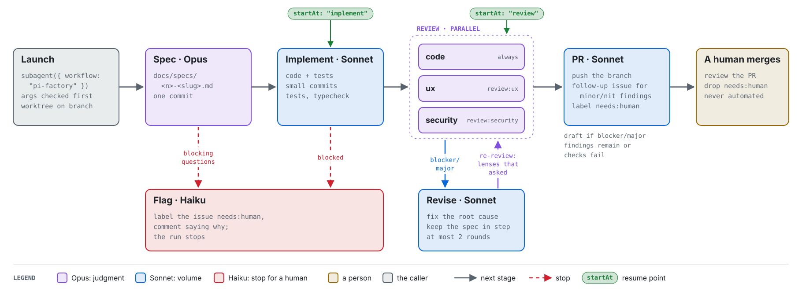

# pi-factory

[](https://github.com/seandavi/pi-factory/actions/workflows/ci.yml)

Turn a GitHub issue into a reviewed pull request with a fixed loop of coding agents: **spec →
implement → review → revise → PR**. It runs as a [pi](https://pi.dev) package on
[pi-subagents](https://github.com/nicobailon/pi-subagents). The strong model (Opus) works where
judgment matters, the fast model (Sonnet) where volume does, and Haiku does the bookkeeping. A
person always merges.

<picture>
  <source media="(prefers-color-scheme: dark)" srcset="docs/figures/factory-flow-dark.svg">
  
</picture>

**Figure 1.** One factory run. Box colour shows the model each stage runs on. Solid arrows are the
normal path. Dashed red arrows are stops, which label the issue `needs:human` and explain why.
Review lenses run in parallel: `code` always, and each lens the repository defines in
`.pi/factory.json` when the issue carries its `review:<lens>` label. Only `blocker` and `major` findings send the branch back to
revise, and only the lenses that asked for changes review again. Green pills are the
`--start-at` resume points. Generated by [`docs/figures/make_figures.py`](docs/figures/make_figures.py).

## What a run produces

| Stage | Model | Writes |
|---|---|---|
| Spec | Opus | `docs/specs/<issue>-<slug>.md`, one commit |
| Implement | Sonnet | code and tests, in small commits |
| Review | Opus, one reviewer per lens | nothing (read-only); findings with ids and severities |
| Revise | Sonnet | fixes for blocker/major findings, spec kept in step |
| PR | Sonnet | the PR, labelled `needs:human`, with a record of every review round; a follow-up issue for minor/nit findings |

**Table 1.** Stages, the model each runs on, and what it leaves in the repository or on GitHub.
The PR opens as a draft if blocker/major findings remain after two revise rounds or if checks
fail. Details: [docs/factory.md](docs/factory.md).

## Install

```sh
pi install git:github.com/seandavi/pi-factory
```

The package tracks `main`; `pi update` brings in the latest. It adds the `/factory` command and
registers the workflow as the named pi-subagents resource `pi-factory`.

## Set up a repository

Add `AGENTS.md` (every stage reads it first) and `.pi/factory.json`: where the design lives, the
review lenses, the checks to run and any project rules for the stages. Start from an example:
[bioc-mcp](examples/bioc-mcp.factory.json) (TypeScript Worker, `code`/`ux`/`security` lenses) or
[bioc-support-archive](examples/bioc-support-archive.factory.json) (Python pipeline and a Worker,
`code`/`ux`/`privacy`). The fields are in [docs/factory.md](docs/factory.md#configuring-a-repository).

Create the labels the factory uses. `needs:human` is required (every stop and every PR carries it;
`/factory` refuses to start without it); `seam` and one `review:<lens>` per lens other than `code` let
issues ask for them:

```sh
gh label create needs:human --description "Waiting on a person"
gh label create seam --description "Shared foundation; reviewers rate by blast radius"
gh label create review:ux --description "Add the ux review lens"   # one per lens in .pi/factory.json
```

## Run it on an issue

In pi, inside the repository:

```text
/factory 12 --dry-run     # see the worktree, branch, lenses and args
/factory 12               # create the worktree and launch the run
```

Lenses come from the issue's `review:<lens>` labels, and the `seam` label marks a shared
foundation. Resume with `--start-at implement` or `--start-at review` (an issue keeps its branch even if it is retitled). Then work your queue:
`gh issue list -l needs:human` and `gh pr list -l needs:human`.

## Status

An experiment that is becoming a shared engine. The workflow was copied from
[seandavi/bioc-mcp](https://github.com/seandavi/bioc-mcp) (commit `e51c13f`, 2026-10-22), where it
ran about 25 issues; its project block now lives in [examples/bioc-mcp.factory.json](examples/bioc-mcp.factory.json).
The [tracking issue](https://github.com/seandavi/pi-factory/issues/1) lays out the path:

- [x] Installable pi package, launched by name ([#2](https://github.com/seandavi/pi-factory/issues/2))
- [x] `/factory <issue>` launcher and per-repo `.pi/factory.json`, so no project text lives in the
      engine ([#3](https://github.com/seandavi/pi-factory/issues/3))
- [ ] Reviewers always get the diff ([#4](https://github.com/seandavi/pi-factory/issues/4))
- [ ] Integration step before the PR: merge main and run the full checks
      ([#5](https://github.com/seandavi/pi-factory/issues/5))
- [ ] Migrate bioc-mcp and bioc-support-archive to the shared engine
      ([#6](https://github.com/seandavi/pi-factory/issues/6),
      [#7](https://github.com/seandavi/pi-factory/issues/7))

Until #6 and #7 land, those two repositories keep their own copies.

### Lessons carried over from bioc-mcp

What worked: parallel review lenses that find real problems; fix-judging (re-reviewers judge the
fix, not just the symptom); seam-aware severity; specs kept in step with code; follow-up issues;
`needs:human` on every stop; `startAt` to resume. What was missing, and the open issues address:
an integration step (semantic merge breaks between parallel PRs surfaced only when merged by hand),
reviewers that always see the diff, and one shared copy instead of drifting ports.

## Contributing

Issues and PRs are welcome; see [CONTRIBUTING.md](CONTRIBUTING.md). Reports of real factory runs,
good or bad, are the most useful contribution right now: use the **Factory run report** issue
template. Report security problems privately ([SECURITY.md](SECURITY.md)). This project follows the
[Contributor Covenant](CODE_OF_CONDUCT.md).

## License

[Apache 2.0](LICENSE), as the bioc-mcp original.
